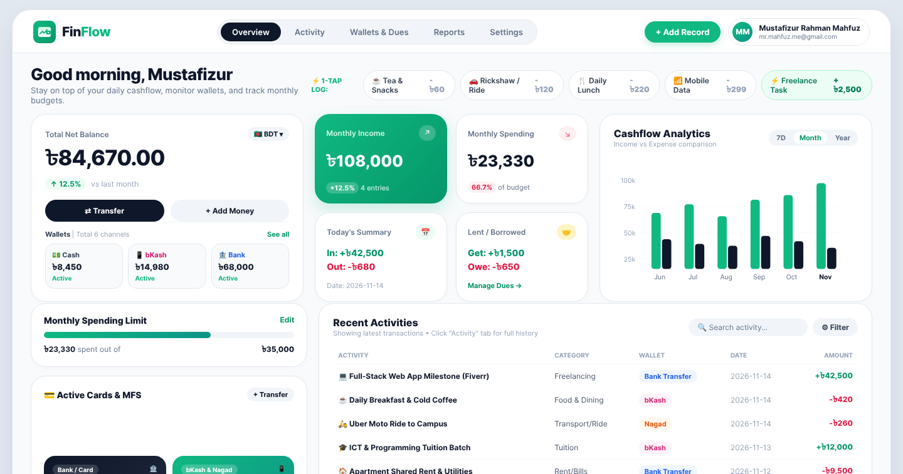
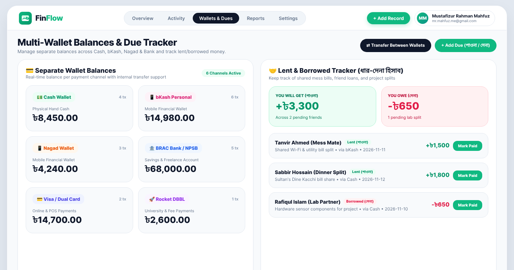
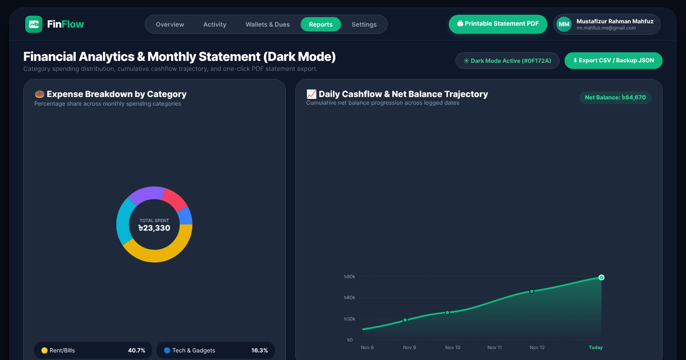

# 💸 FinFlow — Smart Personal Money Tracker & Financial Analytics

**FinFlow** is a modern, multi-user Personal Money Tracker & Financial Analytics web application built with **React.js (Vite)**, **Tailwind CSS**, **Lucide React**, and **Recharts**. Designed with a clean, spacious **Minimal Bento UI**, it empowers students, freelancers, and professionals to track daily cashflow, manage separate Bangladeshi payment wallets (`Cash`, `bKash`, `Nagad`, `Rocket`, `Bank Transfer`, `Card`), and settle friend dues effortlessly.

---

## 📸 Application Screenshots

### 1. Minimal Bento Overview Dashboard (Light Mode)


### 2. Multi-Wallet Balances & Lent/Borrowed Due Tracker (`পাওনা / দেনা`)


### 3. Visual Analytics, Category Donut & Printable Statement (Dark Mode)


---

## ✨ Key Features

- **🎨 Brand Identity & Custom Favicon (`public/favicon.svg`)**: Emerald Green (`#10B981` to `#059669`) and Slate (`#0F172A` Dark Mode / `#F8FAFC` Light Mode) palette with reusable `<FinFlowLogo />`.
- **🔐 Multi-User Authentication & Zero Data Leakage**: Full Login & Registration system with strict per-user storage isolation (`finflow_transactions_${userId}`, `finflow_dues_${userId}`, `finflow_budget_${userId}`).
- **⚡ 1-Tap Quick Entry Chips**: Log common daily expenses (Tea/Snacks, Rickshaw/Ride, Lunch, Data Pack) in a single click without opening a form.
- **💳 Separate Wallet Balances & Internal Transfer**: View exact balances across **Cash**, **bKash**, **Nagad**, **Rocket**, **Bank Transfer**, and **Card**, and transfer funds between wallets without inflating monthly expense totals.
- **🤝 Lent / Borrowed Due Tracker (`ধার-দেনা হিসাব`)**: Track money friends owe you (`পাওনা`) or money you owe others (`দেনা`) with 1-click settlement.
- **📊 Interactive Recharts Visual Analytics**:
  - 4 Top KPI Summary Tiles (Total Net Balance, Monthly Income with growth badge, Monthly Spending with budget progress & 80% warning alert, Today's Summary & Pending Dues).
  - Grouped Income vs. Expense Bar Chart (`7D`, `Monthly`, `Yearly`).
  - Expense by Category Donut Chart with percentage labels.
  - Cumulative Cashflow Area Chart.
- **📄 Printable Monthly Statement PDF, CSV Export & JSON Backup**: Collapsible table filters, instant keyword search, CSV download, JSON backup/restore, and printable PDF statement view.
- **🚀 Netlify Ready**: Includes `public/_redirects` (`/* /index.html 200`) for zero-config SPA deployment.

---

## 🛠️ Tech Stack

- **Frontend Framework**: React 18 (Vite)
- **Styling**: Tailwind CSS
- **Charts & Analytics**: Recharts
- **Icons**: Lucide React

---

## 🚀 Quick Start (Local Development)

```bash
# 1. Install dependencies
npm install

# 2. Start development server
npm run dev

# 3. Build for production (Netlify / Vercel)
npm run build
```
### 🌐 Live Demo

Check out the live version of FinFlow here: [**View Live Project**](https://finflow-personal-finance.netlify.app/)
---

Developed by **Mustafizur Rahman Mahfuz**
